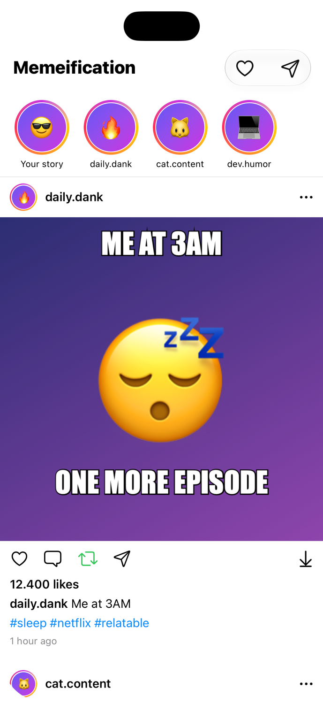
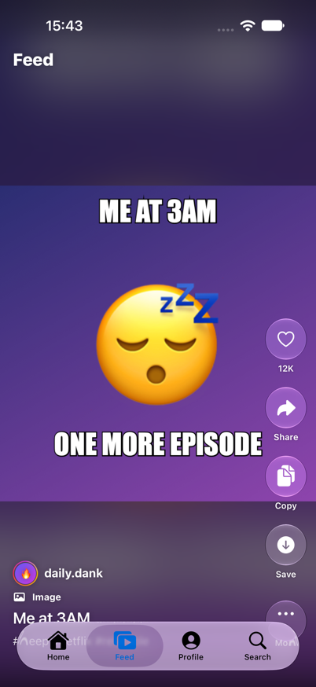
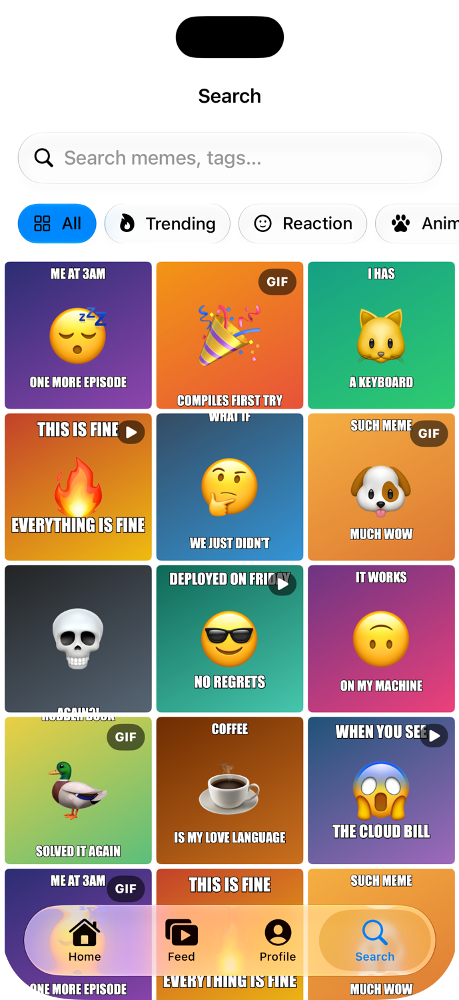
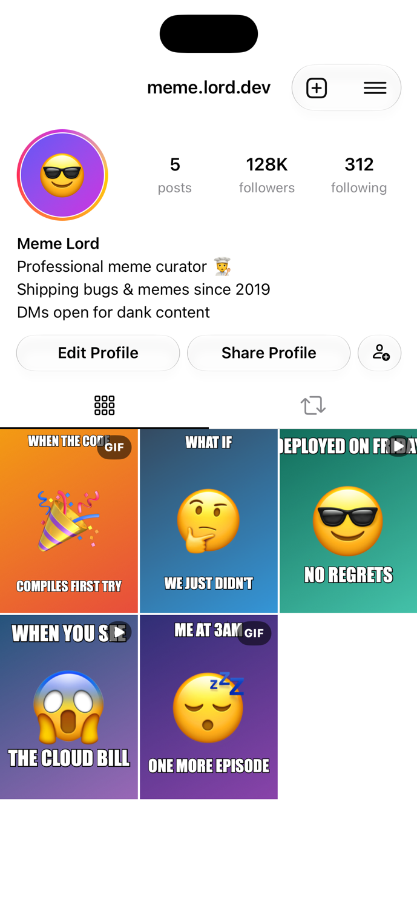

# Memeification

A SwiftUI meme-sharing app prototype for iOS, iPadOS, macOS and visionOS. Scroll a social Home feed, swipe through a full-screen Feed, search and filter memes by category or tag, and share, copy, save or export any meme.

> **Status:** prototype. All content (memes, accounts, likes) is local sample data. There is no backend yet.

## Screenshots

| Home | Feed | Search |
| :---: | :---: | :---: |
|  |  |  |

| Profile | Meme Detail |
| :---: | :---: |
|  |  |

## Features

- **Home**: a feed in the style of Instagram, with a stories row. Posts from accounts you follow come first, newest first. After that comes a "You're all caught up" divider and an endless stream of suggested posts. Supports infinite scrolling, pull to refresh, likes, reposts and following accounts.
- **Feed**: full-screen vertical paging in the style of TikTok, with a glass action rail (like, share, copy, save, more).
- **Search**: search memes by title or tag, filter by category (Trending, Reaction, Animals, Coding, Classic), and browse a grid that shows GIF and video badges.
- **Profile**: avatar, follower stats and bio, with tabs for your uploads and your reposts.
- **Meme actions**: share (`ShareLink`), copy to the clipboard, save to Photos (iOS), export as PNG (`fileExporter`), and favorite.

## Tech Stack

- SwiftUI with the new `Tab` API, including a search tab with `role: .search`
- The Liquid Glass design language
- The Observation framework (`@Observable` models shared through the SwiftUI environment)
- Swift Concurrency (`async`/`await`) for feed pagination
- `Transferable` for sharing and exporting memes as PNG

## Requirements

- Xcode 27 or later
- iOS / iPadOS / macOS / visionOS 27.0 or later

## Getting Started

1. Clone the repository:
   ```bash
   git clone https://github.com/Troanh1508/Memeification.git
   ```
2. Open `Memeification.xcodeproj` in Xcode.
3. Select the **Memeification** scheme and a simulator or device, then build and run (⌘R).

## Project Structure

```
Memeification/
├── MemeificationApp.swift      # App entry point
├── ContentView.swift           # Root TabView (Home, Feed, Profile, Search)
├── Models/
│   ├── Meme.swift              # Meme model, kinds, categories, sample data
│   ├── UserProfile.swift       # Accounts and the signed-in user
│   ├── MemeStore.swift         # Shared observable store (search, follows, favorites, actions)
│   └── HomeFeed.swift          # Paginated Home feed (following first, then discovery)
├── Actions/
│   └── MemeActions.swift       # Copy, save to Photos, PNG export
└── Views/
    ├── Home/                   # Home feed
    ├── Feed/                   # Full-screen vertical feed
    ├── Search/                 # Search and category filters
    ├── Profile/                # Profile, uploads and reposts
    └── Shared/                 # Thumbnails, detail view, action menus
```

## Roadmap

- Real backend and user accounts
- Uploading memes from the photo library
- Animated GIF and video playback
- A recommendation service for discovery posts
